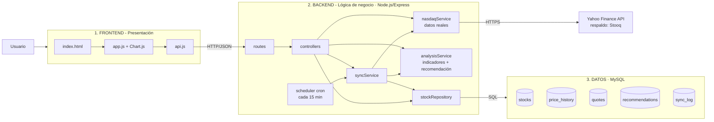
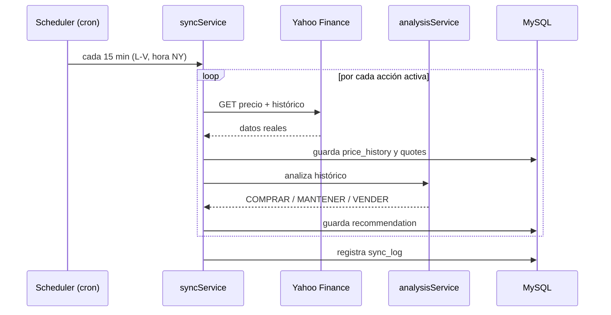

# Sistema de Automatización NASDAQ

Sistema web que **consume valores reales del NASDAQ**, los guarda automáticamente en **MySQL**,
genera **gráficos** y emite **recomendaciones de inversión** (COMPRAR / MANTENER / VENDER).

Corresponde a la tarea **SP-96 – Revisiones y automatización del NASDAQ** (Sprint 3) y además cubre:
- **SP-98** Diagramas (ver sección Arquitectura)
- **SP-99** Seguridad (helmet, rate limit, validación, consultas parametrizadas)
- **SP-103** Inversiones con valores decimales (`DECIMAL(14,4)` + simulador en centavos)
- **SP-106** Base de datos con límites de caracteres (`VARCHAR` con tamaño + `CHECK`)

---

## Arquitectura de 3 capas



| Capa | Carpeta | Responsabilidad |
|------|---------|-----------------|
| Presentación | `frontend/` | Interfaz, tablas, gráficos (Chart.js), formularios. Solo habla con la API. |
| Lógica de negocio | `backend/src/` | Consumir NASDAQ, calcular indicadores, recomendar, automatizar, validar. |
| Datos | `database/schema.sql` | Tablas MySQL, relaciones, tipos decimales y límites de caracteres. |

### Flujo de la automatización



---

## Estructura

```
sistema-nasdaq/
├── database/
│   └── schema.sql              # Capa de datos (tablas + datos iniciales)
├── backend/
│   ├── .env.example            # Configuración (copiar a .env)
│   ├── package.json
│   ├── src/
│   │   ├── server.js           # Arranque, seguridad, sirve el frontend
│   │   ├── config/db.js        # Pool de conexiones MySQL
│   │   ├── routes/             # Endpoints REST
│   │   ├── controllers/        # Manejo de peticiones
│   │   ├── services/
│   │   │   ├── nasdaqService.js    # Consume datos REALES del NASDAQ
│   │   │   ├── analysisService.js  # SMA, RSI, volatilidad, recomendación, simulador
│   │   │   └── syncService.js      # Automatización (descargar → guardar → recomendar)
│   │   ├── app.js              # Aplicación Express (local, Vercel y pruebas)
│   │   ├── repositories/       # MySQL (consultas parametrizadas) o memoria
│   │   └── jobs/               # Cron + sincronización manual
│   └── tests/                  # unit/, integration/ (API), database/
├── api/index.js                # Función serverless para Vercel
├── vercel.json                 # Configuración del despliegue
├── .github/workflows/tests.yml # Pruebas automatizadas (GitHub Actions)
└── frontend/
    ├── index.html
    ├── css/styles.css
    └── js/ (api.js, app.js)
```

---

## Instalación

> **En este equipo ya está todo instalado**: MySQL 8.4 corre como servicio de Windows (`MySQL84`),
> la base `nasdaq_system` está creada y `backend/.env` configurado.
> Solo haga doble clic en **`INICIAR.bat`**. Las contraseñas están en `CREDENCIALES-MYSQL.txt`.

Para instalarlo en otro equipo:

**Requisitos:** Node.js 18 o superior, MySQL 8 (o XAMPP/WAMP con MySQL/MariaDB).

1. **Crear la base de datos**
   ```bash
   mysql -u root -p < database/schema.sql
   ```
   (o abrir `schema.sql` en MySQL Workbench / phpMyAdmin y ejecutarlo)

2. **Configurar el backend**
   ```bash
   cd backend
   cp .env.example .env      # en Windows: copy .env.example .env
   ```
   Editar `.env` con el usuario y contraseña de MySQL.

3. **Instalar y arrancar**
   ```bash
   npm install
   npm start
   ```

4. Abrir **http://localhost:3000**

Al arrancar, el sistema descarga los datos reales de las 8 acciones iniciales
(AAPL, MSFT, NVDA, AMZN, GOOGL, META, TSLA, NFLX) y luego se actualiza solo cada 15 minutos.

Otros comandos:
```bash
npm run sync   # fuerza una sincronización desde consola
npm test       # todas las pruebas (unitarias + API + base de datos)
npm run dev    # modo desarrollo (reinicia al guardar)
```

---

## Pruebas

| Tipo | Carpeta | Qué prueba | Comando |
|------|---------|------------|---------|
| Unitarias | `backend/tests/unit/` | Indicadores (SMA, RSI, volatilidad), recomendación, simulador con decimales, servicio NASDAQ (Yahoo + respaldo Stooq), repositorio y automatización | `npm run test:unit` |
| API (integración) | `backend/tests/integration/` | Todos los endpoints REST de punta a punta, validaciones y seguridad (inyección, límite de 10 KB, cabeceras helmet, rate limit) | `npm run test:api` |
| Base de datos | `backend/tests/database/` | `schema.sql` (tablas, `VARCHAR`, `DECIMAL`, `CHECK`, llaves foráneas) y, con `TEST_MYSQL=1`, pruebas contra un MySQL real | `npm run test:db` |

La fuente de datos externa se **simula** en las pruebas, así que no dependen de internet ni del horario del mercado.

```bash
cd backend
npm test                    # todo
TEST_MYSQL=1 npm run test:db   # incluye las pruebas contra MySQL (usa backend/.env)
npm run test:coverage       # reporte de cobertura
```

### Pruebas automatizadas (CI)

El flujo `.github/workflows/tests.yml` corre solo en GitHub Actions con cada `push` o pull request:

1. **Tests unitarios y de API** (Node.js 22).
2. **Pruebas de base de datos**: levanta un **MySQL 8.4**, ejecuta `database/schema.sql` y prueba las restricciones y el repositorio contra la base real.

El resultado se ve en la pestaña **Actions** del repositorio.

---

## Despliegue en Vercel

- `vercel.json` publica `frontend/` como sitio estático y la API Express como función serverless (`api/index.js`).
- Si en Vercel se configuran las variables `DB_HOST`, `DB_PORT`, `DB_USER`, `DB_PASSWORD` y `DB_NAME` (un MySQL en la nube),
  el sistema usa esa base de datos.
- Sin esas variables usa un **almacenamiento en memoria** con el mismo contrato que MySQL
  (`backend/src/repositories/memoryStockRepository.js`): los datos reales del NASDAQ se descargan en la primera visita.
  En local, con `backend/.env`, sigue usando MySQL.

---

## API REST

| Método | Ruta | Descripción |
|--------|------|-------------|
| GET | `/api/stocks` | Panel: acciones seguidas, último precio y recomendación |
| GET | `/api/stocks/:symbol?range=6mo` | Detalle, gráfico (precio + medias móviles), indicadores, recomendación |
| POST | `/api/stocks` `{ "symbol": "AMD" }` | Agrega una acción al seguimiento automático |
| DELETE | `/api/stocks/:symbol` | Deja de seguir una acción |
| GET | `/api/live/:symbol` | Cotización en vivo directa del NASDAQ (sin guardar) |
| POST | `/api/sync` | Fuerza la sincronización (máx. 3 por minuto) |
| POST | `/api/simulate` `{ "symbol", "amount": "1500.75", "date": "2026-01-02" }` | Simula una inversión con decimales |

---

## Cómo se genera la recomendación

Puntaje de **−100 a +100** combinando 4 señales de análisis técnico:

| Señal | Puntos | Regla |
|-------|--------|-------|
| Tendencia | ±20 | Precio por encima/debajo de la media de 50 días |
| Cruce de medias | ±20 | Media 20 días por encima/debajo de la de 50 |
| RSI (14) | ±30 / ±10 | < 30 sobrevendida (+30), > 70 sobrecomprada (−30), si no ±10 |
| Momentum 1 mes | ±20 | 2 puntos por cada 1 % de variación |
| Riesgo | −10 | Volatilidad anual > 50 % |

- **≥ 25 → COMPRAR** · **≤ −25 → VENDER** · en medio → **MANTENER**

> Modelo académico. No constituye asesoría financiera.

---

## Seguridad (SP-99)

- `helmet`: cabeceras HTTP seguras y Content-Security-Policy.
- `express-rate-limit`: 120 peticiones/min por IP y 3 sincronizaciones/min.
- Validación de símbolos con expresión regular (frontend, backend y `CHECK` en MySQL).
- Consultas SQL **parametrizadas** (`?`) → sin inyección SQL.
- Escape de HTML en el frontend → sin XSS.
- Límite de tamaño del cuerpo JSON (10 KB) y errores internos sin detalles al cliente.
- Credenciales de BD en `.env` (no se sube al repositorio).

## Fuente de datos

- Principal: **Yahoo Finance** (`query1.finance.yahoo.com/v8/finance/chart`) — gratis, sin API key.
- Respaldo automático: **Stooq** (CSV diario) si Yahoo no responde.
- Las cotizaciones tienen el retraso propio de las fuentes gratuitas (aprox. 15 min).
